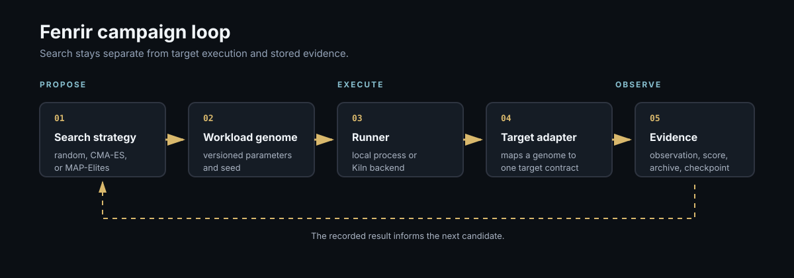

# Fenrir

Search for workloads that make a target system behave badly.

## Canonical hunt

Thirty evaluations per optimizer, three seconds each, identical Norn target, search space, seed, and p99-latency objective.

| Optimizer | Distinct regimes | Best p99 | Throughput at best p99 |
| --- | ---: | ---: | ---: |
| random | 10 | 4,974.49 ms | 665 ops/s |
| CMA-ES | 3 | 4,975.88 ms | 895 ops/s |
| MAP-Elites | 7 | 4,993.38 ms | 2,147 ops/s |

The raw evaluations are committed under [`experiments/canonical/`](experiments/canonical/README.md).
This is a red-team search result, so a larger latency is a worse workload found, not a faster target.

Fenrir treats workload generation as optimization.
A search strategy proposes a versioned genome, the runner executes it through a target adapter, and the measured observation becomes a score, archive entry, and checkpoint.

## Current status

- Random search, CMA-ES, and MAP-Elites work
- Resume restores optimizer and RNG state before the next candidate
- Counterexample minimization preserves the failure oracle and source artifact
- The Norn adapter links the real library
- Weir, Loki, and Orda currently use explicit synthetic adapters
- Bayesian search and Ygg novelty integration are not implemented

Seed replay reproduces generated choices.
It does not promise identical timing measurements.

[Build adapters, run campaigns, inspect the CLI, and add targets](GUIDE.md).

[Canonical optimizer comparison](experiments/canonical/README.md).
